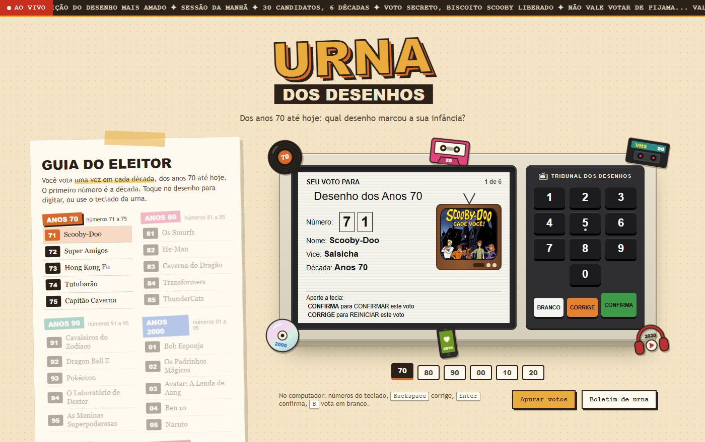
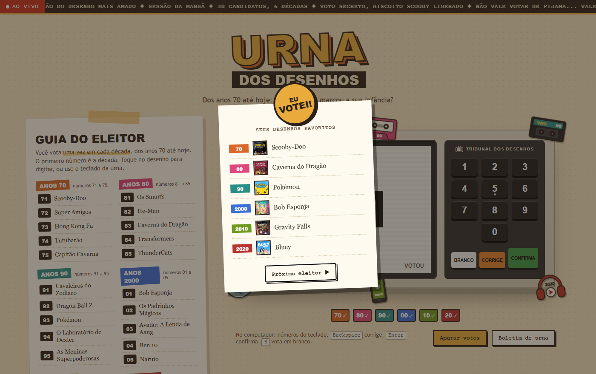
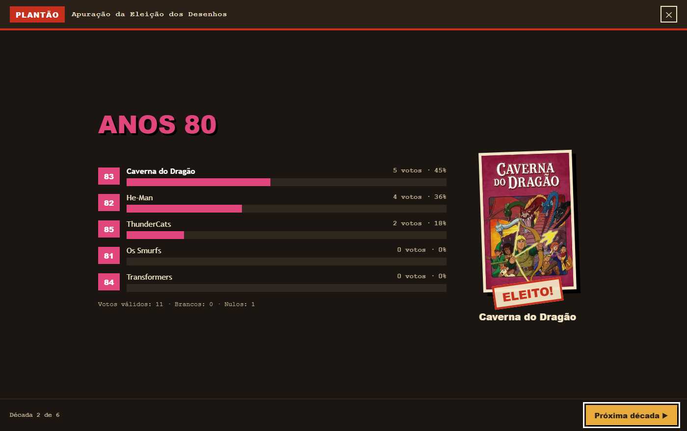

# Urna dos Desenhos

Urna eletrônica temática para votar no desenho animado favorito de cada década, dos anos 70 até os anos 2020. Feita com HTML, CSS e JavaScript puro, sem bibliotecas, como projeto escolar.



## Como funciona

A urna imita a urna eletrônica brasileira. Cada eleitor vota em **6 etapas**, uma por década, como na eleição de verdade (deputado, senador, presidente...).

- O **número** de cada desenho começa pela década: `7x` anos 70, `8x` anos 80, `9x` anos 90, `0x` anos 2000, `1x` anos 2010 e `2x` anos 2020.
- O **Guia do Eleitor**, ao lado da urna, lista os 30 candidatos. Clicar num desenho digita o número na urna.
- Ao digitar o número, o desenho aparece numa TV antiga e toca um trecho da abertura.
- As teclas **BRANCO**, **CORRIGE** e **CONFIRMA** funcionam como na urna real. Número de outra década vira voto nulo.
- No fim, a urna mostra **FIM** e uma cédula "Eu votei!" com os 6 desenhos escolhidos.



### Apuração

O botão **Apurar votos** abre uma apuração em tela cheia, no clima de plantão de TV: uma década por vez, com as barras enchendo e o vencedor revelado com pôster e carimbo de **ELEITO!**. Ao final aparecem os campeões de cada década. Há também um **boletim de urna** no estilo recibo impresso.



## Como abrir

Não precisa instalar nada nem ter internet:

1. Baixe o projeto (botão **Code → Download ZIP**) e descompacte.
2. Abra o arquivo `index.html` no navegador.

No computador também dá para votar pelo teclado: números para digitar, `Enter` confirma, `Backspace` corrige e `B` vota em branco.

Os votos ficam salvos no próprio navegador (`localStorage`). Para recomeçar, use **Zerar urna** no boletim de urna.

## Estrutura

```
index.html      página da urna
css/style.css   visual
js/dados.js     lista de décadas e desenhos (dá para editar sem mexer no resto)
js/urna.js      funcionamento da urna, apuração e sons
img/            pôsteres dos desenhos
sons/           trechos das aberturas
```

## O que pratiquei

- Montar layout com CSS Grid e Flexbox, adaptado para celular
- Manipular a página com JavaScript (DOM, eventos de clique e de teclado)
- Controlar o fluxo da votação por etapas
- Guardar dados no navegador com `localStorage`
- Gerar sons com a Web Audio API e tocar áudio com `Audio`
- Desenhar ilustrações com SVG e animar com CSS

## Créditos e aviso

Projeto **estudantil**, feito **apenas para estudo e sem fins lucrativos**.

- **Imagens:** os pôsteres dos desenhos foram obtidos no [TMDB – The Movie Database](https://www.themoviedb.org/). Este projeto não é endossado nem certificado pelo TMDB.
- **Sons:** os trechos de áudio vêm do [MyInstants](https://www.myinstants.com/) e de aberturas dubladas publicadas no YouTube.
- **Direitos autorais:** os personagens, nomes, imagens e músicas pertencem aos seus respectivos estúdios, emissoras e detentores de direitos. Nenhum material é vendido ou usado comercialmente.

Se você é detentor de algum desses direitos e prefere que o material seja removido, abra uma *issue* neste repositório.
